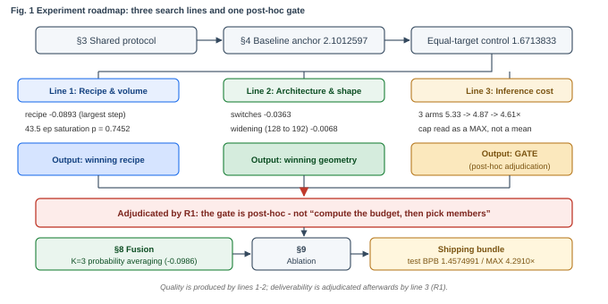
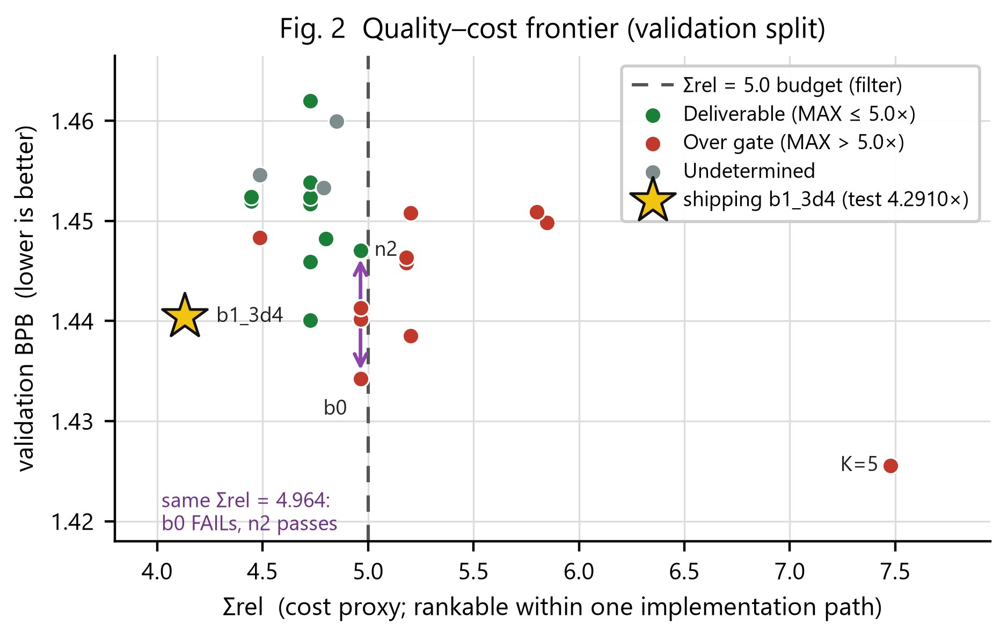

# MP1 Experiment Report

## 1. Task, Scoring Protocol and Hard Constraints

### 1.1 Task and scoring protocol

Train a language model from scratch and push WikiText-2 full-test BPB as low as possible, in FP32, reproducible on CPU. Protocol: WikiText-2 raw text with a BPE-2048 tokenizer fitted on the training text only; independent 256-target causal windows that share one boundary token but carry no state; every target scored once, with each split's first token excluded; the BPB denominator is every raw UTF-8 byte of the split; the submission is the test JSON's `bpb` field.

The supplied baseline is full-test BPB **2.1012597** (validation 2.0710831), architecture `d4w128h4` (1,088,256 parameters), 1,200 × 32 × 256 = 9,830,400 training targets (2.7206 epochs); it takes 5.92 s on the reference machine (4-thread Xeon Platinum 8457C, not guaranteed here). With only 3,613,343 tokens at 2.7206 epochs the problem is **data-constrained**: capacity, training volume and regularisation must be balanced jointly. Scaling laws from the 900B-token / 9B-parameter scale, orders of magnitude away, only indicate direction. Our evidence: doubling the training volume again (43.5 → 87 epochs) saturates at **p = 0.7452** (§5.2); a single model at 471.9M targets still sits at ≈1.67 validation.

### 1.2 Three hard constraints: only one is a real constraint

The shipped artefact was measured on the test split, FP32, 4 threads, **alternating within the same session** with the baseline: CPU scoring time **4.2910×** (MAX of 5 alternating pairs; min/median 3.9523 / 3.9611), peak RAM **2,205.0 MiB**, inference assets **24.938 MiB = 26,149,082 B**.

Only CPU time is a real constraint. Budget-level estimates for assets and RAM (never measured) are superseded by this section's measurement; the qualitative judgement (CPU is the real constraint) agrees, but **the numbers are no longer cited**. The 30 candidate gate decisions corroborate this: every FAIL was on R1; R2 / R3 never neared their ceilings (RAM 2204.7–2230.8 MiB vs 4096; assets 24.915–37.730 MiB vs 64).

R1 is a ratio, and the variance sits in the denominator. Within one validation session the baseline per-target cost spread 21% (14.38–17.44 µs), the ensemble only 4.7%. We read on MAX, because a submission is scored once; the mean would understate the critical value by 5.3×. The same procedure gives 4.6129× on validation, the gap from test coming from the pairing, not the model. The margin boundary (with the failure threshold) is given once only, in §10.1; this section states no other margin figure.

### 1.3 Compliance red lines and known deviations

All three members have `parent_checkpoints = 'none'`, trained from random initialization, no external corpus or pretrained weights; the only learned asset loaded at inference is `bundle/checkpoint.pt`; all selection on the A half of validation, all reporting on the B half; test was read 6 times (1 frozen score plus 5 alternating timing pairs), all returning the same `1.4574991` under the `--frozen` flag, and took part in no selection, tuning or ranking. The supplied evaluator, model, training scripts, `configs/baseline.json`, `tests/` and all `data/` are byte-identical (14 files); the method was frozen before scoring.

One deviation is disclosed (not a red-line violation): two prose files in the release package do not match their manifest hashes. §4 of `code/README.md` had three blank measurement lines, filled in at the publisher's invitation; the guide's hash is `132409af…` against the manifest's `fa62a767…`; the cause is untraced and the discrepancy predates this work. No file the evaluator loads, nor `data/`, nor the tokenizer, is affected.

## 2. Experimental Route and Final Method

### 2.1 Roadmap (Figure 1)



Figure 1, experimental roadmap: the shared conventions (§3), the baseline anchor (§4, 2.1012597), the equal-training-volume control (1.6713833), then three parallel lines — line 1 recipe (−0.0893), line 2 architecture and shape (−0.0363 / −0.0068), line 3 inference cost (5.33 → 4.87 → 4.61×). Line 3's output is not a budget figure but a post-hoc gate; §8 then covers fusion, §9 the ablations, and finally shipment.

### 2.2 Why this order: the cost line is a post-hoc gate

The equal-target control rules out "it was just trained longer"; the three parallel lines (§5–§7) each answer one separable question. Key structure: **line 3 is a post-hoc gate, not an up-front budget**. The best-quality solutions from lines 1 and 2 repeatedly failed on cost: `b0` (val **1.4342282273**) measured FAIL at 6.5625 / 5.9867; the ungated optimum K=5 (val **1.4185338170**) is not submittable; K=4 / K=5 measured **6.2420× / 6.0603×**, over the gate. The shipped set is limited by R1, not ensemble size; every "best quality" claim must carry its cost.

### 2.3 Final method at a glance

Three members `d4w192h4` + RoPE + QK-norm[1][2], seeds **35 / 47 / 37**, each seat 157,286,400 targets, loaded with **EMA weights**[6]; shared recipe in §5.3; inference side K = 3 **probability averaging**, loading `agent7_fastens` (`l4_level = 4`); test BPB **1.4574991**, CPU MAX **4.2910×**, RAM **2,205.0 MiB**, assets **24.938 MiB**. Why this is the method: §5–§8.

## 3. Shared Experimental Conventions

Training volume is `processed_targets = steps × batch_size × 256`. Baseline 1,200 × 32 × 256 = 9,830,400 (2.7206 epochs); shipped members 19,200 × 32 × 256 = **157,286,400** (43.5 epochs). Targets, tokens and windows are three different counts: targets ≠ tokens (the corpus has only 3,613,343 tokens), tokens ≠ windows; `train_tokens` stores a target count, so this report writes **processed training targets**.

For evaluation, validation is 376,599 targets / 1,148,007 B and test is 428,405 targets / 1,292,013 B (each split's token count minus 1). Re-running the same checkpoint is bit-identical, so any BPB difference comes from the weights only. Selection and reporting fix `split_seed = 17`, permuting the validation scored-target indices and halving them: A = 188,299 (selection) / B = 188,300 (reporting); always select on A, report on B; a run's members and their non-EMA twins may not hold two seats at once.

The significance line is **0.0087 BPB** = 2 × pooled se 0.00435 (long-tier three-seed mean, sd 0.00533 / √3 × √2). It is **unpaired**, hence **conservative** for the paired comparisons in this report. Retraining with the same recipe and seed is not bit-reproducible (final BPB differs by +2.0e-5 ~ +6.8e-4), so 0.0087 applies only to multi-seed means, never a single-seed pair; reporting always uses ≥3 seeds as mean ± std. On cost, `Σrel` sums the members' geometric rel; `ratio = Σrel × k / base`, read on MAX; `k_plain = 5.73`, `k_active = 7.04` s/rel; the implementation-side discount is **0.859** (most conservative). The shipped bundle has Σrel = **4.131128** (raw 29.08 s, discounted 24.98 s). Four Σrel-ceiling values appeared (4.92 / 5.9834 / ≈5.142 / 5.5546), **reported in parallel without adjudication**; when conventions conflict, the measured MAX governs.

## 4. Baseline Reproduction and Equal-Training-Volume Control

Baseline reproduction: official full-test BPB 2.1012597, our value bit-identical (validation 2.0710831). The equal-target control is the denominator for every later Δ: baseline architecture and recipe trained to the same 157,286,400 targets as the shipped members, 3 seeds, same scorer, same split:

| | processed targets | validation BPB (3-seed mean) | full-test BPB (3-seed mean) |
|---|---:|---:|---:|
| baseline `d4w128h4`, supplied recipe | 157,286,400 | **1.6713833** | **1.6952304** |
| shipped ensemble (157,286,400 per seat) | 157,286,400 each | 1.4404595 | **1.4574991** |

Per-seed test readings for the control are 1.6984118 / 1.6962172 / 1.6910621; the ensemble is **0.2336** below the best of them. The alternative "it just trained on 3× more targets" is excluded: 19,200 against 38,400 updates, same architecture and recipe, **p = 0.7452** (saturation); a single model at 471.9M targets still sits at ≈1.67 validation.

## 5. Line 1 · Recipe and Training Volume

Of the 8 axes, 7 have a measured sweep, 3 seeds per tier, **all pre-registered**: each arm's `abandon_if` fixed its read-out threshold before any numbers existed. Most important: **lr × wd is an interaction term, not the sum of two main effects** (four cells, same architecture, same targets, same seeds, paired control):

| Perturbation | Σlr | Σ(lr·wd) | Δ vs anchor | Read |
|---|---:|---:|---:|---|
| anchor lr1e-3 / wd0.1 | 1.00× | 1.00× | 0 (1.6713833) | reference |
| **raise lr only** (lr5e-3 / wd0.02, Σ(lr·wd) pinned by back-solving) | 5.00× | 1.00× | **−0.0004** (paired t = −0.141) | **clean zero** |
| **raise wd only** (lr1e-3 / wd0.3) | 1.00× | 2.99× | +0.0032 | **zero** |
| **raise both** (lr5e-3 / wd0.1) | 5.00× | 5.00× | **−0.0367** (t −9.07, 4.21× line) | **real gain** |

Conclusion: raising lr and wd together, proportionally (Σ(lr·wd) about 5–6.5×), buys about 0.037–0.039 BPB, not "lr 5e-3" alone. Boundary: that arm has only 3 seeds, df = 2, a "failure to reject the null", not a "proof of zero".

### 5.1 Results (Table 1)

> Anchor 1.6713833; ✅ = over the line and better, ❌ = over the line and worse, ⚪ = within the line; "Δ÷line" = \|Δ\| / 0.0087. **Table note**: the significance line is an unpaired statistic, conservative for the paired comparisons in this report.

| Recipe item | Tier | val BPB | Δ vs anchor | Δ÷line | Over line | Conclusion |
|---|---|---:|---:|---:|:---:|---|
| **anchor** | lr1e-3/cos/wd0.1/wu100/drop0/ema0 | **1.6713833** | 0 | — | — | this line's denominator |
| **lr** | **5e-3** | **1.6347149** | **−0.0367** | **4.21** | ✅ | **winner** (2e-3 also over the line, −0.0168) |
| Σ(lr·wd) ladder | 1.00× (wd0.02, lr raised only) | 1.6709808 | **−0.0004** | 0.05 | ⚪ | **clean zero** (t −0.141) |
| **schedule** | **d2z @5e-3 (golden)** | **1.6023611** | **−0.0690** | **7.93** | ✅ | **this project's largest single-model gain** (t −15.55) |
| EMA | 0.999 (d2z@1e-3 convention) | 1.6430812 | **−0.0283** (EMA effect −0.0073) | 3.25 | ✅ | sub-additive |
| **batch** | 32 (only tier) | — | — | — | **not measured** | **never swept; not "closed" and not "no gain"** |

Tiers that did not make the table: dropout 0.1 / 0.2 gives 1.6826 / 1.7573 (+0.0112 / +0.0860, i.e. 1.29 / 9.88 × line), **monotonically** worse, axis closed; wd = 1.0 is −0.0149 under `decay_scope = matrices` (1.71× line) but collapses to +0.3251 under `all` (attributed to the LN gain/bias group), the narrow-scope wd optimum still unswept; lr = 5e-4 gives +0.0110; Σ(lr·wd) = 15.00× (wd0.3, all) gives a paired +0.0329 (t +4.17). Reported in parallel without adjudication: the EMA effect size is −0.0106 / −0.0073 / ≈0.015~0.017 under three conventions, and this table adopts `d2z`. The recipe alone (lr5e-3 / d2z / wd0.1 / EMA0.999, same architecture, same targets) gives a solo of **1.5820762**, Δ = **−0.0893**, the **largest single step** in the four-step decomposition.

### 5.2 Training volume (epoch) axis

| epoch | steps | targets | val BPB (3 seeds) | adjacent gain / Welch p | verdict |
|---:|---:|---:|---:|---:|---|
| 2.72 | 1,200 | 9,830,400 | 2.0742939 | — | baseline training volume |
| 5.44 | 2,400 | 19,660,800 | 1.8770846 | −0.1972 / not recorded | over the line (22.7× line) |
| 10.9 | 4,800 | 39,321,600 | 1.7472492 | −0.1298 / 1.15e-05 | significant |
| 21.8 | 9,600 | 78,643,200 | 1.6885748 | −0.0587 / 0.00015 | significant |
| **43.5** | **19,200** | **157,286,400** | **1.6713833** | −0.0172 / 0.0133 | significant (t −4.37) |
| 87 | 38,400 | 314,572,800 | 1.6701260 | **−0.0013 / 0.7452** | **saturated** (t −0.35) |

The per-arm sd ranges from 0.0031 to 0.0053, and **the noise floor varies with step count (a span of about 1.7×), so it must not be carried across regimes**; at 43.5 ep the validation BPB is still falling (t ≈ 4), the slope flattening rather than turning up, so this is not overfitting. Doubling again (76,800 steps, a two-variable change) gives a paired solo Δ̄ of **+0.0782** (6/6 positive), +0.0195 at ensemble-arm level. The short-budget screening trap: the rankings of the 8 geometries at 2.72 ep and 43.5 ep are **exactly inverted** (Spearman ρ = −0.9286, n = 8, 8/8 reversed sign, p ≈ 0.002); acting on the short-tier ranking would ship a model 0.35 BPB worse than the baseline. **Capacity helps at short budgets and hurts at the real one**; the short tier must not be used for architecture / scale decisions.

### 5.3 Conclusions for this line

Shipped recipe: `lr 0.005` / `d2z` (cosine decay to 10%, warm-down 0.2) / `wd 0.1` / `warmup 100` / `dropout 0` / **EMA 0.999** / FP32 / tied embedding / steps 19,200 / batch 32 / context 256. Closed axes: wd ladder (best arm wins by only 0.0025 < 0.0087, tripping the pre-registered gate); T1.1b decomposition axis (5 of 6 arms worse); dropout (monotonically positive Δ); warmup (flat, non-monotonic, kept at 100); lr frontier > 5e-3 (flat top; 6.5e-3 is not validated); training volume > 43.5 ep (not a methodological contribution). **The batch axis is "not measured", not "closed".**

## 6. Line 2 · Architecture and Shape

### 6.1 Shape sweep (Table 2)

The rel and parameter counts come from the cost table, and the best solo validation BPB comes from the 924-run inventory (840 of those runs completed the full 43.5 epochs).

| Geometry | Parameters | rel | Best solo val BPB | Verdict |
|---|---:|---:|---:|---|
| `d4w128h4` | 1,088,256 | 1.000 | 1.5821 | baseline geometry |
| `d5w128h4` | 1,286,528 | 1.1378 | **1.5518** | excellent, steepest in the table (0.046 rel / 0.01 BPB) |
| **`d4w192h4`** | 2,222,208 | **1.3770** | **1.5390** (RoPE+QK-norm variant; plain best 1.5436) | **shipped geometry** |
| `d4w256h4` | 3,749,376 | 1.8552 | 1.5463 | ❌ the evidence does not support "keep widening" |
| `d8w192h4` | 4,001,664 | 2.2100 | **1.5355** (best single model in the table) | ❌ very poor value (2.38 rel / 0.01 BPB) |

Two further geometries: `d2w256h4` (rel 1.2128, 1.5625) already surpassed, `d3w256h4` (rel 1.5289, 1.5558) a negative gain. The larger geometries `d4w256h8` / `d4w320h4` / `d6w256h8` are also negative gains, or were only trained at lr = 1e-3, but they are **not evidence that "big models don't work"** (full grid in the traceability ledger).

The frontier saturates sharply after rel ≈ 1.4: doubling depth (`d4w192h4` → `d8w192h4`) spends +0.833 rel to buy back only −0.0035, a marginal slope of 2.38, ~50× worse than the 0.046 of the `d5w128h4` segment; a negative-gain segment also appears (`d4w256h4` is 0.478 rel dearer yet 0.0073 worse). **The single-model quality ceiling is ≈ 1.535.**

### 6.2 Mechanism switches: essentially unchanged parameter count, but not zero cost

The Q4 sweep used same-seed pairing plus a one-sided t read-out (n = 5): 45 arms × 5 seeds = 225 runs; ADOPT 2 / UNDECIDED 19 / REJECT 24, NO-DATA 0.

| Switch (arm) | mean(d) BPB | Verdict (t) | Parameter change |
|---|---:|---|---:|
| RoPE base 10000 alone | −0.0036 | UNDECIDED (−0.78) | −32,768 |
| QK-norm alone | −0.0071 | UNDECIDED (−1.10) | +512 |
| RoPE + QK-norm + ema999 | **−0.0138** | **ADOPT** (t −2.42, p 0.0363) | −32,128 |
| other REJECT arms: RoPE base 100 / no positional encoding / attention temperature | +0.0328 / +0.0919 / +0.0068 | REJECT (+19.49 / +7.37 / +2.18) | −32,768 / −32,768 / +4 |
| **independent single-variable control for RoPE+QK-norm on the shipped geometry** | **−0.0363** (solo 1.5753249 → 1.5390429) | same shape / same seed / same budget / same recipe | see the parameter account |

The rows do not share a control: rows 1 / 2 / 4 are against `s3m_d4_golden`, row 3 against `s3m_d5_golden_ema999` (d5w128h4 + EMA999; its −32,128 = −32,768 + 640, where 640 = 5 layers × 2 norms × (g + b) × head_dim 32), each parameter change counted against its own control; all were run on the Q4 budget, not the shipped geometry and budget, so **their effect sizes cannot be added**; −0.0363 is an **independent single-variable control on the shipped geometry**, not the sum of the other rows. Under multiple-comparison correction (BH / FDR, q = 0.01–0.20, all 0 rejections) those 45 arms are null (2.25 expected false positives, exactly 2 ADOPTs observed), the two readings reported in parallel without adjudication. RoPE + QK-norm is adopted on **that control row, not on the Q4 sweep**. The parameter account confirms the switches take effect: 2,222,208 (plain `d4w192h4`) − 49,152 (position table 256 × 192, gone after RoPE) + 768 (4 layers × 2 norms × (g + b) × head_dim 48) = **2,173,824**, bit-identical to every member's `metrics.json`. On CPU cost the mechanism variants are **+31% ~ +53%** dearer at an **essentially unchanged parameter count**, the only group over the "30% recoverable band".

The list trimmed on literature priors (RoPE, QK-Norm, Muon, label smoothing)[1][2][5] falls into three states: RoPE + QK-norm **is supported by measurement and ships** (−0.0363), Muon **was later measured and killed** (§11), label smoothing **has never been run and counts as "not measured"**, not a negative result. **This implementation's QK-norm differs from [2] in one respect**: [2] applies LayerNorm to the queries and keys with centring and bias removed; here it keeps its affine parameters. The same normalisation is also applied **per head** (`head_dim = width / heads`), before the positional rotation.

### 6.3 Conclusions for this line

**The shipped members are not the best solo single models in the whole project** (1.5390 > 1.5355); they were chosen for **quality per unit of rel + three seats of the same shape + passing the gate**, not for single-model optimality.

- Ceiling = **1.5355** (`d8w192h4`, rel 2.21): the ensemble is **0.0986 = 11.3× line** better than its own best member; matching it with a single model would need rel ≈ 4.8 (an optimistic extrapolation), while the largest rel measured is 2.61.
- That ceiling **no fair-condition run has yet overturned** (the two largest geometries were only ever trained at lr = 1e-3 project-wide); four "best single-model" values (**1.5355 / 1.5379 / 1.5390429 / 1.552136**) come from different conventions and are **reported in parallel without adjudication**; the body cites only 1.5355 and 1.5390429.

## 7. Line 3 · Inference Cost and Budget

### 7.1 The cost model's role and its failure

The cost model is a filter, not an instrument: it screens before submission and flags overruns; ranking errors on the order of 3% have no consequence, and only prediction errors beyond the 30% band are booked. It did fail: parameter count does not predict CPU time (the table below shares one baseline end-to-end reading of 6.057 s):

| model | parameters | layers × width | measured scorer seconds |
|---|---:|---|---:|
| baseline | 1,088,256 | 4 × 128 | 6.057 |
| `d5w128h4` | 1,286,528 | 5 × 128 | **8.258** |
| `d4w192h4` (plain) | 2,222,208 | 4 × 192 | 7.893 |
| `d8w192h4` | 4,001,664 | 8 × 192 | 13.134 |

**"A 128-wide model has 42% fewer parameters than a 192-wide one and is 4.6% slower"**. This contrast is explained by **the latency term (depth) dominates the FLOP-like account at this scale** (same-source evidence: `d8w192h4` has 1.80× the parameters but only 1.66× the time).

Cases where the prediction misled us: one ensemble predicted at 3.72×, measured at 4.90–5.70×, rejected on that basis; one K=4 bundle was blocked by the prediction and never measured, the after-the-fact measurement giving 5.9036, ✗. The conclusion matches the prediction, but the decision order — a prediction in place of a measurement — was wrong. Folding the member axis into the batch axis gives **68.04 s vs 22.81 s = a 2.98× regression**, **a memory-traffic problem, not a FLOP problem**. The Σrel threshold is no more usable as a gate: a set with Σrel = 4.964 < 5.0 still measured FAIL. Almost all the spread in the ratio sits in the denominator; we read on MAX (a submission is scored once); two disciplines: CPU timing is unusable while a GPU training wave runs (one three-arm reading was voided by CPU contention and re-run on a quiet machine), and the A / B arms must have symmetric memory conditions.

### 7.2 Three inference-side optimisation tiers (Table 3)

Three arms were run back to back in the same session, on the same frozen checkpoint and a quiet machine, taking the worst of 5 runs:

| Tier | Implementation | Worst ratio | BPB | Verdict |
|---|---|---:|---:|---|
| **control** | `student` path, `l4_level = 0` | **5.3277×** | 1.4404595 | **FAILS** (> 5.0); the unaccelerated bundle does not pass the gate |
| optimised tier 1 | `agent7_fastens`, `l4_level = 1` | **4.8666×** | 1.4404595 | OK |
| **optimised tier 2 (shipped)** | `agent7_fastens`, `l4_level = 4` | **4.6129×** (val) / test MAX **4.2910×** | 1.4404595 | **OK (shipped)** |

It changes only the order in which the arithmetic is combined, not the computation: all three arms give BPB **1.4404595, identical across all 15 repeats**; the load-bearing check is the weight fingerprint — the shipped bundle's per-member fp32 tensor bytes (name-sorted, concatenated) sha256 = `e6defa8b…ae662` / `8000066c…26df9c` / `a034204d…8d7da`, reproduced bit-identically after repacking into a different serialisation container; the bit-exact nll gate `nll_nats = 1146228.1313961744` agrees across all three arms. Without it the same file measures 5.3277× FAIL in the control arm, so this is an R1 **correctness requirement, not an optional optimisation**.

The level 4 increment over level 1 varies in direction across four sessions / conventions (0.8659 / 1.00830 / 0.9991 / level 2 = 0.9228), **reported in parallel without adjudication**. This report's account of the gate boundary **does not depend on level 4**; what is load-bearing is level 1.

### 7.3 Conclusions for this line

- Conversion rate: taking the most unfavourable observed denominator of 5.641, ratio ≤ 5.0 allows Σrel = 4.92; after a −15% cost-engineering delivery it allows 5.79. Worked out, "**every 10% cut in cost engineering is about 0.5 rel given away for free ≈ half a seat**".
- **The ratio that measurement actually buys back**: three readings of the fastens coefficient, 0.8869 / 0.9052 / 0.8659, a range of **0.865–0.905**; the accounting uses 0.859 (most conservative).
- Residual risk: whether the gate holds depends on the grader's baseline reading, and **the margin boundary (including the failure threshold) is in §10.1**; all 10 measurements spanning two splits were inside the gate. This section gives no other margin figure.

## 8. Fusion: from a Single Model to a K-Member Ensemble

### 8.1 Mechanism definition

`p̄(y | x_≤t) = (1/K) Σ_k p_k(y | x_≤t)`, i.e. `log p̄ = logaddexp_k(log p_k) − log K`.

Why probability averaging, not weight averaging? Weight averaging requires the members to fall in the same loss basin; probability averaging requires only that each be a valid predictor on its own, and it **tolerates active disagreement between members** — "disagreeing with each other" is exactly where the ensemble gain comes from. §9.4 measures why the weight-space version fails here; probability averaging's gain comes from the seat-removal ablation in §9.1 (−0.0986, 11.3× line).

### 8.2 Candidate pool, pruning and pricing

How the tier-setting search narrowed down: deduplicated 922 → priceable 898 → 277 remain after removing non-activated families → cost-feasibility pruning removed nothing → quality pruning kept 60 / discarded 217 → exhaustive enumeration of **36,050** K ≤ 3 subsets (= C(60,3)+C(60,2)+C(60,1), bit-identical to the script's printout, **enumeration complete**) → 30,654 within budget. "Not found" must be kept apart from "not looked at": what was enumerated is those 36,050 K ≤ 3 subsets; **K ≥ 4 over the same 60-member pool (`C(60,4) = 487,635`) was never enumerated, which falls under "not looked at", not "not there", and is recorded as not measured**. Root cause: **the tool's default enumeration ceiling quietly defined the search space** — when `C(n,k)` exceeds the ceiling the search prints one SKIPPED line and moves on (its greedy table hard-codes `for k in (1,2,3,4)`). Cost-feasibility pruning is a dominance argument (nothing removed from the 277); quality pruning is a heuristic and must be self-verified: the best discarded B-tier solo is 1.5736129, 40th of all 277, and **all top-10 B-tier solo scores are retained**; its limitation: the K = 3 cooperative optimum may lie outside the pool. Pricing goes by `ens_seconds ≈ Σrel × k`; the shipped candidates use `Σrel × 7.04 × 0.859`.

### 8.3 Member selection: a pre-registered null result

The pre-registered threshold, fixed before the run: the new bundle's half-B BPB must be more than 0.0087 below the **incumbent 1.4431457**, and its cost must pass the gate. Measured, the best within budget on the A half is `s40 + s41 + s35`, `bpb_B = 1.4410330`, **Δ = −0.00211** < 0.0087, **no adoption, incumbent maintained** — **a null result, reported honestly as null**: the 4 new seeds brought no gain beyond noise. Three accompanying facts: (i) the new members are better solo (s40 1.5368796, against the shipped three's 1.5399 / 1.5399 / 1.5390), but swapping them into the triple moves it by only −0.0021, a **very low transfer rate**; (ii) **a better bundle does exist, and what blocks it is R1 rather than quality**: the last row of the Pareto frontier has `bpb_B = 1.4323006` (0.0108 below the incumbent, past the significance line), yet FAILs under both denominators; about 0.0108 BPB was given up deliberately to hold R1; (iii) winner's curse: the incumbent ranks 1194 on the A half and 1247 on the B half out of the 36,050 subsets, a drift of 53 places.

The independent exhaustive search for K = 4 also returns null: neither 114,855 subsets (raw ≤ 31.5 s) nor a second pass over 73,815 feasible combinations (raw ≤ 30.1 s) beat the shipped set; the best compliant k = 4 was 0.0224 and 0.0307 BPB worse. Both ran on the "compliant pool", not the 60-member pool of §8.2 (where K ≥ 4 was never enumerated). Within the gate, the marginal gain from k = 3 → 4 is +0.0224 / +0.0245 / +0.0307 across three sub-sweeps, reported in parallel without adjudication. The null holds only for "the pool enumerated + those two searches".

### 8.4 The final shipped bundle (Table 4)

| Item | Value |
|---|---|
| Member geometry × K / seeds; parameters / training targets per member | `d4w192h4` + RoPE + QK-norm, all three seats identical (K = 3); seeds **35 / 47 / 37**; **2,173,824** / **157,286,400** (19,200 × 32 × 256), total parameters 6,521,472 |
| Per-member solo validation BPB | 1.5398847 (s35) / 1.5398679 (s47) / 1.5390429 (s37) |
| **val BPB / full-test BPB (frozen)** | **1.4404595** (half-A 1.4377736 / half-B 1.4431457) / **1.4574991** (exact `1.4574990646`) |
| **CPU ratio (MAX)** | test **4.2910×** (3.9523 / 3.9611 / **4.2910**); validation **4.6129×**. This row reports the measured multiples only; **the margin boundary (including the failure threshold) is in §10.1** |
| Peak RAM / inference assets | **2,205.0 MiB** / **24.938 MiB = 26,149,082 B** (margins and their failure thresholds are in Table 7, §10.1) |
| Σrel / cost / loading | **4.131128**; raw **29.08 s** / fastens-discounted **24.98 s** / `implementation = 'agent7_fastens'`, `l4_level = 4`; EMA weights; K = 3 probability averaging |

Any citation of the cost figures has to carry the qualifiers: `b1_3d4` and `g1` are the same bundle (BPB 1.4404595450, Σrel 4.131128, model 29.08 s, all bit-identical); one "measured FAIL: MAX 5.2273" reading is **without fastens**, and with fastens is 4.5733.

### 8.5 Quality–cost frontier (Figure 2)



Figure 2, quality–cost frontier. The horizontal axis is the cost proxy **Σrel** (orderable only within one implementation path; across paths multiply by `k_plain = 5.73` or `k_active = 7.04` s/rel), the vertical axis is **val BPB** (lower is better), and the threshold is the **MAX of the measured ratio** (≤ 5.0× shippable, > 5.0× over the gate). The **29 points** come from this section's pricing sheet (32 rows, 3 with no recorded Σrel); green = shippable, red = over the gate, grey = quality not detected. The **star** marks the shipped point; the four points this section discusses — `b1_3d4`, `b0`, `n2` and the K=5 footnote — are labelled in place, and the vertical double arrow marks the two that share Σrel = 4.964 yet land on opposite sides of the gate; the vertical dashed line at Σrel = 5.0 is only a budget filter, **not the real boundary**.

Σrel works only as a filter. `b0` has Σrel **4.964132** < 5.0, yet measures FAIL at **6.5625 / 5.9867**; `n2` has the **same Σrel of 4.964132** yet PASSes at **4.5633** (the lowest ratio observed). The red and green point at the same Σrel is the direct evidence: **the real boundary can only come from measuring bundle by bundle**. Three points must be marked: **`b0`** (val **1.4342282273**, better than the shipped point yet unable to pass the gate); the **K=5 footnote** (val **1.4255519690**, Σrel **7.478716**, over budget and sitting right at the gate, whose seeds for seats 3–5 **were not found in the repository archive, marked `*` as they stand (recorded as not measured), and must not be filled in**); and **`b1_3d4`** (the shipped point, test MAX **4.2910×**).

On the ungated side there are two more anchors: K = 5 val **1.4185338170** (not submittable); the k sequence (K = 1→5) 1.5398847 / 1.4675860 / 1.4404595 / 1.4263119 / 1.4185338 improves monotonically, but k = 4 / 5 measured 6.2420× / 6.0603×, over the gate. **That sequence is internally inconsistent in convention** (the third entry, 1.4404595, is a full-validation value, whereas half-B k = 3 should be 1.4431457), reported in parallel without adjudication, and **the figure must not mix them**. In one sentence: **"the frontier saturates sharply after rel ≈ 1.4; the whole 0.10 BPB from the best single model at 1.535 to the best ensemble at 1.434 comes from ensembling (variance reduction), not from scale."**

## 9. Ablations

### 9.1 Main-mechanism ablation: removing seats (Table 5)

The key mechanism is probability averaging over three members; ablating it means removing seats. **All 7 non-empty subsets** are scored on validation, ordered on A and reported on B:

| K | Subset | half-B BPB | Δ vs shipped set | Δ / 0.0087 |
|---:|---|---|---:|---:|
| 1 | s37 / s35 / s47 | 1.5413965 / 1.5430833 / 1.5433412 | +0.0983 / +0.0999 / +0.1002 | **11.3 / 11.5 / 11.5** |
| 2 | s35+s37 / s47+s37 | 1.4696352 / 1.4696400 | +0.0265 / +0.0265 | **3.0 / 3.0** |
| 2 | s35 + s47 | 1.4708625 | +0.0277 | **3.2** |
| **3** | **s35 + s47 + s37 (shipped set)** | **1.4431457** | **0** | **0** |

**Every removal crosses the significance line, including the cheapest one** (+0.0265, 3.0× line). The ensemble is not a marginal effect and the third seat is not redundant; K = 3 is not yet saturated, but K = 4 cannot pass the cost gate, so 3 is the cap. This table is also the price list for the seat bought to pass the gate: dropping to the best pair costs **+0.0265 BPB**, a **demonstrated loss, not a free hedge**.

### 9.2 Gain decomposition (Table 6)

The path from 1.6952304 (the equal-target control's full-test) to 1.4574991 mixes four changes, each step holding the others fixed; the last two steps are single-variable (same shape, same seed, same budget, same recipe).

| Step | Control variables (what is held fixed) | Δ (val) | Share of the val total 0.2310 |
|---|---|---:|---:|
| start: baseline `d4w128h4`, supplied recipe | — | — (**1.6713833**) | — |
| **+ recipe** (lr5e-3, d2z, wd0.1) | same architecture, same targets; 3-seed search optimum = 1.5820762 | **−0.0893** | **38.7%** |
| **+ width** (128 → 192) | plain architecture, recipe fixed; **same-seed 37 pairing (not the whole-library optimum)**, plain solo 1.5753249 | **−0.0068** | **2.9%** |
| **+ RoPE & QK-norm** | shape and seed fixed at `d4w192h4` / 37; variant solo 1.5390429 | **−0.0363** | **15.7%** |
| **+ ensemble** (1 member → 3 seeds) | §9.1 | **−0.0986** | **42.7%** |
| **total (sum of the four steps)** | | **−0.2310** | **100.0%** |

The decomposition reconciles: the four-step sum, −0.2310, **≈** the measured total difference of −0.2309 (1.6713833 → 1.4404595; 0.2309238 rounds to 0.2309, while the 0.2310 is four individually rounded terms summed, so they differ by 1e-4). Qualifier: "width" here takes the **same-seed paired value for seed 37** (1.5753249); the plain best **1.5436** for `d4w192h4` in Table 2 is a **whole-library best-solo** convention, **and the two must not be subtracted**; the decomposition reconciles only for the former. Heaviest item: **recipe and ensemble together account for about four-fifths (val 81.3% / test 79.0%), and the recipe half of that is free at inference by construction** (lr / schedule / wd / EMA live in the optimizer and the training side and change no operator executed at inference; the pricing formula `Σrel × k` contains geometry terms only). **This is a structural argument, not a paired measurement**; this study did not run the paired experiment of "changing the recipe only and measuring inference seconds". Second: **mechanism switches are worth more than width** (−0.0363 vs −0.0068), netting −48,384 parameters (parameter ledger in §6.2).

### 9.3 Diversity-source ablation: seeds vs shapes

The three shipped members differ solo within the significance line (a span of only **0.00084**, 1.5390429 – 1.5398847), statistically indistinguishable; yet the ensemble beats its own best member by **0.0986 = 11.3× line**, and removing any member costs 0.0265–0.0277 at k = 2 and 0.098–0.100 at k = 1. **The gain comes from "being wrong in different ways", not from "differences in individual quality".** Now the direct comparison with a shape-diversified ensemble (a negative result: it is worse):

| | previous generation, shape-diversified ensemble (earlier submission 1.4620084; members d4w192h4 + d5w128h4 + d8w192h4) | **same shape, different seeds (shipped set b1_3d4; members d4w192h4 × 3)** |
|---|---|---|
| member solo (full val) | 1.5753 / 1.5676 / 1.5937 | 1.5399 / 1.5399 / 1.5390 |
| ensemble K = 3 (full val / half-B) | **1.4620084** / 1.4649171 | **1.4404595** / **1.4431457** |
| Σrel → seconds | **4.7249** (× `k_plain` 5.73) → 27.07 s | 4.1311 (× `k_active` 7.04) → 29.08 s |

Shape diversification spreads members more widely, but **the ensemble is worse**: the same-shape seed ensemble is better by **+0.0215 (2.5× line)**. The two sides' k differ (left `k_plain = 5.73`, right `k_active = 7.04`), so the "only 2.01 s dearer" comparison **crosses implementation paths** and is an order-of-magnitude reference only. Two qualifiers: (i) the comparison is **between shapes**, the mechanism switches held constant across all three; (ii) **a three-member ablation cannot separate "seed diversity" from "more parameters"**; the "training duration" reading is excluded by the saturation control in §4 (p = 0.7452), not by this ablation.

### 9.4 Reverse ablation: why weight merging does not work

Merging the three members into one set of weights would cost 1× instead of 3× — the only mechanism that could buy back cost headroom without losing ensemble width. First the instrument is excluded: the symmetry group is solved exactly (residual-stream permutation ∈ S₁₂₈, per-layer MLP hidden permutation ∈ S₅₁₂, head permutation and within-head permutation)[4], and the implementation recovers **2704 / 2704 (100.00%)** on a known answer, `max|A − align(B)| = 0`. The barrier[7] survives alignment (local lab: `d4w256h4_s17/18/19`, same architecture and recipe, differing only in seed, single models all 1.8139): **naive average merging 3.7570, barrier = +1.9431**; **aligned merging 3.7407, barrier = +1.9268**, so alignment recovers only 0.0163 BPB.

Two independent chains reproduce this. (i) Pool-member side: a single member `w4_s36_only` **1.6192**, the naive average of three same-family seeds `w4_soup3` **3.4977** (collapse of **+1.8785**); qualifier: a soup is a single predictor competing against a single model, not an ensemble, so even without collapse it could not reach 1.44. **`w8_soup3` was never scored and is recorded as "not measured", not as a failure.** (ii) P2-14 (pre-registered, with CI / MDE, n = 39): cross-seed endpoint average minus own endpoint = **+1.8206** (CI ±0.0501, MDE 0.0712, past the MDE), the cluster level past it too; `SWA4 − delivered-form EMA = +0.0040` (not detected, sign unfavourable); the regression `SWA_gain ≈ 0.8076 × EMA_gain` (R² = 0.8433), so the two harvest the same end-of-trajectory variance while EMA is stronger. Instrument limitation: the delivered family has no intermediate ckpt, so the P2-14 reading is a same-schedule-family proxy surface, not the shipped artefact. Top1 match rate in two independent diagnostics: weight matching `pi` **0.406**, activation matching `pi` **0.449**; random baseline 0.0039 / 0.001, CONTROL = 1.000, so the matcher is finding real structure, but both channels are wrong by about 55%–59%, and `pi` top1 falls monotonically from 0.449 at the embedding output to 0.254 at the last layer. **This is not "the same set of features relabelled", it is two different solutions.** Note that **0.406 / 0.449 are match rates, not the relative size of the barrier**; the barrier is always absolute BPB, **+1.9431 (after alignment +1.9268)**.

### 9.5 What the ablations establish and what they do not

**(i) Effect sizes measured.** Removing seats crosses the line at every tier (cheapest k = 3→2 is +0.0265 = 3.0× line, dearest k = 3→1 is +0.098~+0.100 = 11.3~11.5× line); shape diversification is **worse by +0.0215 = 2.5× line**; the decomposition closes at −0.2310. The paired bootstrap 95% CI per subset of the shipped set **was not found in the repository**.

**(ii) Not established either way (which is not the same as the opposite being established).** **The alternative path of a larger single model has never been closed**: in the priced geometry grid, every shape passes all three gates on its own, and even the worst, `d6w256h8`, reaches only 2.9158× (58.3% of R1) and 20.33 MiB (31.8% of R3); the one width step actually run (128 → 192) is worth only −0.0068. Training longer, the inseparability of seed diversity from parameter count, and the cost model's inability to gate are likewise not established either way.

**(iii) Not to be extrapolated.** The conclusion holds at ~2M–5M parameters, 4–8 layers, width 128–256, BPE-2048, on 3,613,343 tokens, at 43.5 epochs (a severely over-trained regime); all wall-clock multiples were measured on one machine, while final scoring happens on the grader's machine (the same baseline reads 5.92 s on the reference machine and 8.3929 s here, a factor of 1.42).

## 10. Resource Compliance, Cost and AI-Use Disclosure

### 10.1 The three hard constraints as measured (Table 7)

| Constraint | Ceiling | Measured (test) | Measured (validation) | Margin |
|---|---:|---:|---:|---:|
| CPU ratio (MAX, 5 alternating pairs) | ≤5× | **4.2910×** (3.9523 / 3.9611 / **4.2910**) | **4.6129×** | test **14.2%**; val 7.7% |
| Peak RAM | ≤4 GiB | **2,205.0 MiB** | 2,204.9 MiB | **46%** |
| Inference assets (uncompressed) | ≤64 MiB | **24.938 MiB** = 26,149,082 B | — | **61%** |

> **Table note**: the full meaning of the "margin" column (including the failure thresholds) is in the margin-boundary paragraph at the end of this section (a margin is not a guarantee). Elsewhere a reference to a margin only points here and does not restate the figures.

Measurement procedure: baseline and ensemble **alternate within the same repeat**, 5 alternating pairs, FP32, 4 threads, the official `evaluate.py`, the `--frozen` flag; 10/10 readings return the same BPB, so what is repeated is time, not score. RAM comes from external RSS measurement, not from `peak_allocated_gb` in the evaluate.py JSON (a CUDA counter, reading 0.0 on CPU).

The honest boundary of the margin (the only full statement in this report): passing the gate requires the grader's baseline to be **≥ 28.616 / 5.0 = 5.72 s** (official reference value 5.92 s); the fastest baseline reading in this session is **5.2232 s**, and under that denominator the test numerator of 28.616 s would read **5.48×, over the gate**. Pairing it with the validation ensemble of 25.277 s gives 4.839× (a margin of only 3.2%), but that is a **cross-session worst case, not a measurement**. The pre-registered mitigation and its price: buy margin with the ensemble size k; dropping to the best two seats costs **+0.0265 BPB = 3.0× line**, a loss measured rather than a free hedge. **This is a margin statement, not a guarantee.**

### 10.2 Training and search cost

| Item | Value |
|---|---|
| total runs / total GPU hours / total targets | **1,008 runs** (those with metrics.json) / **400.2 GPU·h** / **143.93 G** |
| cost of the shipped members themselves | **7,280.7 s = 2.02 GPU·h** (per member 2,426.5 / 2,427.6 / 2,426.6 s) |
| search overhead multiple / CPU-side evaluation and search (est.) | **398.2 GPU·h ≈ 197× the shipped members**, members being 0.51% of total compute / **8–12 CPU·h** |

On the principle that "reusing a checkpoint does not erase its training cost", this report gives the full **400.2 GPU·h**. All 1,008 runs record `device = cuda:0`; the members have `parent_checkpoints = 'none'`.

### 10.3 test usage

test was read 6 times in total: 1 for the frozen score, 5 within the alternating timing pairs of §10.1; all six returned the same `1.4574991` under the `--frozen` flag. **Did it take part in any selection: it did not.** All selection was on the A / B halves of validation; the member pool, the subsets and the pre-registered thresholds were finalised before any test read.

### 10.4 AI-use disclosure

This work used substantial AI assistance: AI helped draft and iterate the search, enumeration, packaging and measurement tooling, design and run the recipe and architecture searches, write `agent7_fastens.py`, and draft this report. **This includes code the evaluator loads**: the shipped checkpoint's `implementation` field points at `agent7_fastens`, on the scoring path. AI did not write the supplied `model.py` / `evaluate.py` / `common.py`, and did not modify the data or tokenizer; all three members were trained from random initialization. Before shipment we verified that the module does not change the score: the three arms, run on the same checkpoint, all return `bpb 1.4404595` on validation.

## 11. Negative Results and Boundaries (Table 8)

> Discipline: each row = **verdict + evidence + closing action**; no "the trend is right" and no "it seems worse". Anything that was never run is marked **not measured**, not written as a failure.

| # | Direction | Conclusion (verdict) | Closing action |
|---|---|---|---|
| 1 | cross-seed weight averaging / model soup[3] | **Failure**: naive cross-seed averaging gives val **3.4977** (members solo **1.6192**, collapse **+1.8785**); lab barrier **+1.9431 / +1.9268 aligned**; symmetry group solved, two diagnostics still top1 only 0.406 / 0.449 | weight-space merging **closed**; replaced by probability averaging (§8.1) |
| 1b | `w8_soup3` | **not measured** (no reading anywhere in the repository) | the report must write **not measured**, not a failure |
| 2 | cost model (Σrel / parameter-count proxy) | **Failure**: 42% fewer parameters yet 4.6% slower; errors +16% (candidate sets), +19% (single model), +31%~+53% (mechanism variants; another convention +12%~+20%, reported in parallel without adjudication); one ensemble predicted 3.72×, measured 4.90–5.70×, rejected on that basis | demoted to a screener / pruner; resource-gate decisions must be taken on end-to-end measurement |
| 3 | exhaustive member selection | **null**: exhaustive enumeration of 36,050 K ≤ 3 subsets over the 60-member pool, best selected on A gives **Δ = −0.00211** < 0.0087 ⇒ incumbent maintained | reported honestly as null; the pruning self-verification record is disclosed alongside |
| 5 | the four inference-side speed-up levers | **all no gain or backwards**: batching a 2.98× regression (memory traffic); `mallopt` 1.02093 with peak RSS +165.7 MiB; head-chunked parsing upper bound 3.8279 s = 0.4448× of the 8.6067 s requirement; the de-variant `P/S = 0.8588` triggering the criterion | all four rolled back; shipment keeps the plain K serial passes. Head chunking can only be reported as "**the evidence does not support this direction**", not as "the opposite has been established" |
| 7 | **Muon optimizer**[5] | **killed: worse, not "not detected"**: accum 1 (= the delivered operating point) Δ = **+0.1399** (CI ±0.0455, MDE 0.0523, n = 2); accum 16 Δ = +0.2210 | the pre-registered criterion triggers ⇒ closed |
| 7b | **Label smoothing** | **not measured (never run)**: the code is ready, but there is no result reading anywhere in the repository | the report must write "**not measured**", not a negative result |
| 12 | short budget (2.72 epoch) as an architecture screening proxy | **inverted, failure**: Spearman ρ = −0.9286 across the two tiers for 8 architectures (n = 8, 8/8 reversed sign, p ≈ 0.002); selecting on the short-tier ranking picks the worst performer at the long tier | the proxy is closed; all architecture conclusions use 43.5 epoch only |
| 14 | **n-gram count fusion** | **adopted on quality → killed at delivery**: adopted 09-22 (half-B −0.0089, ratio 4.5502); on 09-23 the pre-registered criterion "pessimistic envelope margin < 3% ⇒ kill" triggered, measured −0.93%, the pre-shipment reading falling on the FAIL side | removed from the delivery tree; its test reading deliberately not taken |
| 15 | shape diversification (buying diversity with shape) | **firm negative result**: **worse by +0.0215 than the same-shape seed ensemble (2.5× the significance line)** | the three seats stay same-shape, different-seed |

Other closed directions: training side, self-distillation (Δ **+1.1087**) and training longer, 76,800 steps (paired Δ̄ **+0.0782**, 6/6 positive); architecture side, bigram hash / SwiGLU / mixer replacement (+0.004 ~ +0.522), cross-layer parameter sharing (+0.055 ~ +0.081, all REJECT under 5-seed pairing), mechanism diversity (205 qualifying members, the best 25 within a 0.0034 BPB band); inference side, temperature / member reweighting (peak c = 1.04 worth only −0.00142, −0.0003 after fitting the weights). One class needs its own note: **changing the tokenizer / changing the data (deduplication, curriculum learning, pruning) / external or pretrained weights / MoE / structured sparsity are not applicable (violating the hard constraints or data-constrained), not "ineffective"**; nor may this be written as "deduplication is ineffective for BPB" or "MoE is ineffective".

## 12. Reproduction and Delivery Checklist

One-command scoring (run from the `code/` directory):

```bash
python evaluate.py --checkpoint ../bundle/checkpoint.pt \
    --device cpu --precision fp32 --threads 4 --split test --output peer-test.json
```

| Field | Expected value |
|---|---|
| **`bpb`** | **1.4574991** (exact `1.4574990646`) |
| **`targets`** | **428405** |
| **`utf8_bytes`** | **1292013** |

(`--split validation` expects `bpb = 1.4404595`.) Artefact identity hashes: bundle `checkpoint.pt` = `94b5af1ea5282bf86ec6543cacb3bd90138895b7516f626f8cebfac31af03259` (26,149,082 B) | `agent7_fastens.py` = `de64fa1e33cb8504840a3d8f6a50a8922378e932eb92da2ce892896496691de4` | `student.py` = `af8856febd7b3bc31d60753d3970a10eef42a4266e98767512195cae08c66dee` (also the `implementation_sha256` recorded in each member's `metrics.json`). The loading path is `agent7_fastens.py → student.py → model.py (+ data/tokenizer)`; the full installation, training and artefact checklist lives in the repository README (the retraining command is in its §3), and supplied-file consistency is in §1.3.

## 13. Critical Analysis

The takeaway is not the number "1.4575" but four caveats. **The shipped set is the optimum under the cost constraint, not the quality optimum**: ungated, K = 5 reaches val 1.4185; to hold R1 we gave up about 0.0108 BPB deliberately (§8.3). **The bulk of the gain is not in the architecture**: in the four-step decomposition, recipe (−0.0893) and ensemble (−0.0986) together account for about four-fifths, the recipe half of that being free at inference by construction, while shape and mechanism switches together account for only about one-fifth; this runs against the intuition that "a bigger model would win", but follows from the task's 3.6M-token corpus. **Three alternative paths are still open**: a larger single model (not established either way), K ≥ 4 combinations over the 60-member pool (never enumerated), and the batch and label smoothing axes (never measured); writing any of them as "established against" or as "failed" is wrong. Last: the CPU gate is not robust here, it depends on the grader's baseline reading, and **the margin boundary (including the failure threshold) is in §10.1**; **this is a boundary statement, not a guarantee.**

## 14. References

This report reuses the following published work (bracketed numbers match the in-text markers).

[1] J. Su, Y. Lu, S. Pan, A. Murtadha, B. Wen and Y. Liu, "RoFormer: Enhanced Transformer with Rotary Position Embedding", arXiv:2104.09864, 2021 (published in Neurocomputing, 2024).

[2] M. Dehghani, J. Djolonga, B. Mustafa et al., "Scaling Vision Transformers to 22 Billion Parameters", ICML 2023 (PMLR 202), arXiv:2302.05442.

[3] M. Wortsman, G. Ilharco, S. Y. Gadre et al., "Model soups: averaging weights of multiple fine-tuned models improves accuracy without increasing inference time", ICML 2022 (PMLR 162: 23965-23998), arXiv:2203.05482.

[4] S. K. Ainsworth, J. Hayase and S. Srinivasa, "Git Re-Basin: Merging Models modulo Permutation Symmetries", ICLR 2023, arXiv:2209.04836.

[5] K. Jordan, Y. Jin, V. Boza, J. You, F. Cesista, L. Newhouse and J. Bernstein, "Muon: An optimizer for hidden layers in neural networks", 2024, https://kellerjordan.github.io/posts/muon/; for large-scale validation see J. Liu, J. Su, X. Yao et al., "Muon is Scalable for LLM Training", arXiv:2502.16982, 2025.

[6] B. T. Polyak and A. B. Juditsky, "Acceleration of Stochastic Approximation by Averaging", SIAM Journal on Control and Optimization, 30(4): 838-855, 1992, DOI 10.1137/0330046.

[7] T. Garipov, P. Izmailov, D. Podoprikhin, D. Vetrov and A. G. Wilson, "Loss Surfaces, Mode Connectivity, and Fast Ensembling of DNNs", NeurIPS 2018, arXiv:1802.10026.
